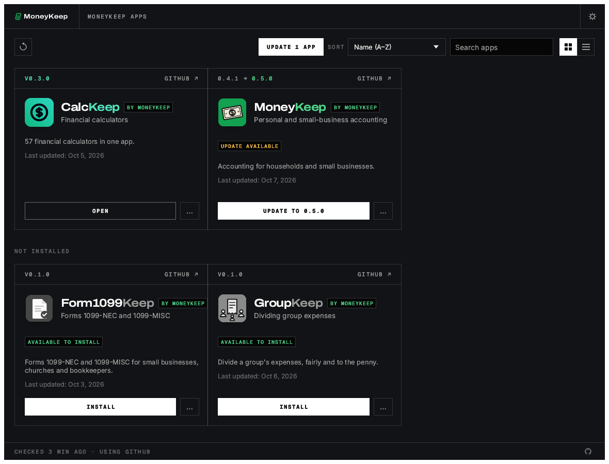
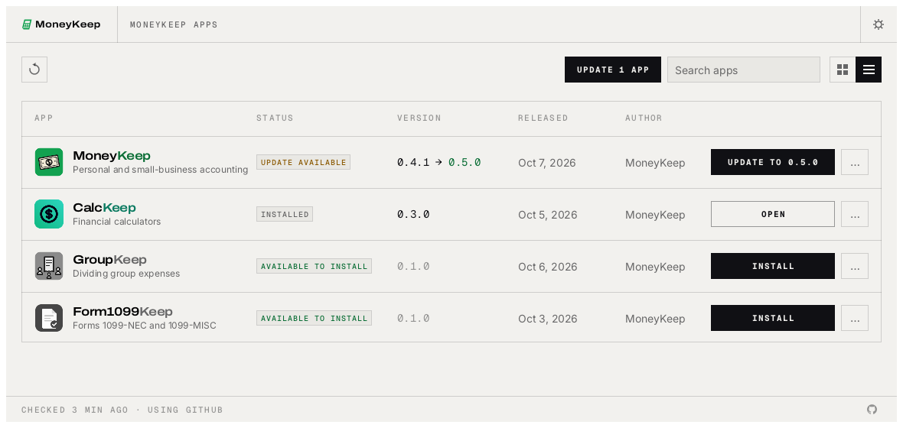

<p align="center">
  <picture>
    <source media="(prefers-color-scheme: dark)" srcset="docs/brand/moneykeep-logo-white.svg">
    
  </picture>
</p>

<p align="center">
  
</p>

<h1 align="center">MoneyKeep Launcher</h1>

<p align="center">
  <b>MoneyKeep – Apps for Financial Management.</b><br>
  One place to install, update and open every MoneyKeep app: the right build for your computer, kept up to date.
</p>

<p align="center">
  
  
  
  
</p>

<p align="center">
  <a href="https://github.com/moneykeepproject/keep-launcher/releases"><b>Download MoneyKeep Launcher</b></a> ·
  <a href="#the-moneykeep-apps">The MoneyKeep Apps</a> ·
  <a href="#build-from-source">Build from source</a>
</p>

<p align="center">
  
</p>
<p align="center">
  <br>
  <sub>Switch between the grid and a sortable table.</sub>
</p>

## What it does

The MoneyKeep apps each ship their own builds for every platform. MoneyKeep Launcher saves you from
hunting through release pages: it lists every app in the suite, shows which ones you have and which
version, installs the right build for your operating system and processor, and tells you when an
update is out. It is a small native app that can sit in your menu bar or system tray.

## The MoneyKeep Apps

| | App | What it's for | Code |
|:-:|---|---|---|
|  | **MoneyKeep** | Personal and small-business accounting | [GitHub](https://github.com/moneykeepproject/moneykeep) |
|  | **CalcKeep** | Financial calculators | [GitHub](https://github.com/moneykeepproject/calckeep) |
|  | **GroupKeep** | Dividing group expenses | [GitHub](https://github.com/moneykeepproject/groupkeep) |
|  | **Form1099Keep** | Forms 1099-NEC and 1099-MISC | [GitHub](https://github.com/moneykeepproject/form1099keep) |

## Features

<table>
  <tr>
    <td width="33%" valign="top">
      <h3>📦 Install in one click</h3>
      Picks the right download for your OS and CPU (DMG, MSI or setup .exe, AppImage, .deb, .rpm and more), checks it against the release's SHA-256 checksums and installs it.
    </td>
    <td width="33%" valign="top">
      <h3>🔄 Stay up to date</h3>
      Checks each app's GitHub releases and updates the ones you have. A notification tells you when there's something new.
    </td>
    <td width="33%" valign="top">
      <h3>🧭 Always at hand</h3>
      Opens any MoneyKeep app from one window, or from the tray and menu-bar icon. Native egui, no Electron, no web view.
    </td>
  </tr>
</table>

The web version shows the same catalog in the browser, with the latest download for each app.

## Interface languages

The interface is in English, Brazilian Portuguese (Português (Brasil)), Czech (Čeština), French
(Français), Georgian (ქართული), German (Deutsch), Hungarian (Magyar), Japanese (日本語), Polish
(Polski), Russian (Русский), Simplified Chinese (简体中文), Traditional Chinese (繁體中文) or Spanish
(Español). **Auto**, the default, follows the system or browser language; **Settings → Language**
picks one and switches at once, and the choice is kept between runs. Czech locales (`cs-CZ`,
`cs_CZ.UTF-8`…) select Czech, Georgian ones (`ka`, `ka-GE`, `ka_GE.UTF-8`…) Georgian, German ones
(`de-DE`, `de-AT`, `de-CH`, `de_DE.UTF-8`…) German, French ones (`fr-FR`, `fr-CA`…) French, Hungarian
ones (`hu`, `hu-HU`, `hu_HU.UTF-8`…) Hungarian, Japanese ones (`ja`, `ja-JP`, `ja_JP.UTF-8`…)
Japanese, Polish ones (`pl`, `pl-PL`, `pl_PL.UTF-8`) Polish, Spanish ones (`es-ES`, `es-MX`,
`es-419`…) Spanish, and Portuguese ones (`pt-BR`, and `pt-PT` too, for now) Brazilian Portuguese.
Simplified Chinese locales (`zh-CN`, `zh-SG`, `zh-Hans`, and POSIX forms such as `zh_CN.UTF-8`)
select Simplified Chinese; Traditional Chinese ones (`zh-TW`, `zh-HK`, `zh-MO`, `zh-Hant`, and POSIX
forms such as `zh_TW.UTF-8`) select Traditional Chinese, with an explicit script winning over the
region. To try a language without changing the setting, start the desktop app with
`KEEP_LAUNCHER_LOCALE=pt-BR`, or add `?lang=ru` to the web address.

The CJK languages are drawn with the system's own CJK font (Hiragino Sans or PingFang on macOS,
Yu Gothic, Meiryo or Microsoft YaHei on Windows, Noto Sans CJK, IPA, Takao or WenQuanYi on Linux and
FreeBSD); Traditional Chinese prefers an installed Noto Sans CJK TC, then PingFang TC, Microsoft
JhengHei or MingLiU. Georgian is drawn the same way, with the system's Georgian font (SF Georgian or
Arial Unicode on macOS, Sylfaen on Windows, Noto Sans Georgian or DejaVu Sans on Linux and FreeBSD).
Where the system has no font for one, and in the web version, the interface stays in English and
Settings says why. Product names and release notes stay as published; text without a translation
falls back to English. See [`docs/localization-zh-hant.md`](docs/localization-zh-hant.md) for the
Traditional Chinese catalog and font details.

## Where apps are installed

MoneyKeep Launcher installs each app where your system normally keeps applications, using the
app's official release package, so an app installed by the launcher is the same as one you
installed by hand (and the launcher finds apps you installed yourself):

| System | Where | How |
|---|---|---|
| macOS | `/Applications/<App>.app` | Copied from the signed, notarized release DMG. Until the MoneyKeep apps' macOS builds are signed with a Developer ID, the launcher opens a copy you installed yourself and links to the release, but doesn't install one |
| Windows | `C:\Program Files\MoneyKeep\<App>` (`Program Files (x86)` for a 32-bit build) | The release MSI, through Windows Installer, for everyone on the computer (with Start menu entry and Apps & features entry). Windows asks for administrator permission for each new install. An app already installed for your account only (`%LOCALAPPDATA%\Programs\MoneyKeep\<App>`) keeps its folder and scope when updated; to move it, uninstall it and install it again |
| Linux | `/usr/bin`, `/usr/share/applications` | The release `.deb` (apt) or `.rpm` (dnf, zypper), with your system's password prompt. Without those, a Flatpak, or an AppImage in `~/Applications` |
| Linux, inside the launcher's Flatpak, with no Flatpak on the host | `~/.var/app/com.moneykeep.keep-launcher/data/keep-launcher/apps/<app>` | The release tarball, unpacked into the launcher's own folder and run inside the same sandbox, with its settings in a `home/` folder beside it. Nothing is installed on the host, and each app's configuration stays in the sandbox |
| FreeBSD | `/usr/local` | The release tree, with a password prompt (polkit); `~/.local` when polkit isn't installed |

MoneyKeep Launcher keeps itself current too: when a new version is out, **Update and restart**
downloads it, verifies it, puts it where this copy is installed (the `.app`, the Windows Installer
package or portable folder, the AppImage, or the `.deb`/`.rpm`) and reopens it.

Updates use the same format an app was installed with. Every download is checked against the
release's published SHA-256 before it is installed, and a running app is never replaced.

The launcher writes its log to `logs/keep-launcher.log` in its data folder
(`~/.local/share/keep-launcher` on Linux, `~/Library/Application Support/MoneyKeep Launcher`
on macOS, `%LOCALAPPDATA%\MoneyKeep Launcher` on Windows, `MoneyKeepLauncherData` beside the
portable zip's executable) and keeps the previous two runs as `keep-launcher.1.log` and
`keep-launcher.2.log`. `RUST_LOG` changes what it records (`debug`, `info,zbus=warn`, …).

## Downloads

Download the build for your computer from the newest release on the [releases page](https://github.com/moneykeepproject/keep-launcher/releases). Every release has a `SHA256SUMS.txt` to check the files against. `<ver>` is the version number, for example `0.1.0`.

Version 0.1.0: [release notes](docs/release-notes/0.1.0.md) · [known limits](docs/known-limits.md).

**Windows** (10 and 11)

| File | What it is |
|---|---|
| `keep-launcher-<ver>-windows-x64.msi` | Installer for most PCs (Intel and AMD, 64-bit). Installs for the current user, no admin rights needed |
| `keep-launcher-<ver>-windows-arm64.msi` | Installer for Windows on Arm (Snapdragon and other Arm PCs) |
| `keep-launcher-<ver>-windows-x86.msi` | Installer for 32-bit Windows |
| `keep-launcher-<ver>-windows-{x64,arm64,x86}-portable.zip` | No install: unzip and run `keep-launcher.exe`. Keeps its settings in the folder |

**macOS** (11 Big Sur or later)

| File | What it is |
|---|---|
| `keep-launcher-<ver>-macos-universal.dmg` | Universal app for Apple silicon and Intel Macs. Signed ad hoc until the project has an Apple Developer ID, so the first time, right-click it and choose Open. Drag MoneyKeep Launcher to Applications |

**Linux** (x86_64 and aarch64; glibc 2.35 or newer, e.g. Ubuntu 22.04+, Debian 12+, Fedora 36+)

| File | What it is |
|---|---|
| `keep-launcher-<ver>-linux-{x86_64,aarch64}.AppImage` | Runs on almost any distro without installing; `chmod +x` and run. The `.AppImage.zsync` beside it lets AppImageUpdate fetch only what changed |
| `keep-launcher-<ver>-linux-{x86_64,aarch64}.deb` | Debian, Ubuntu, Mint, Pop!_OS: `sudo apt install ./keep-launcher-…deb` |
| `keep-launcher-<ver>-linux-{x86_64,aarch64}.rpm` | Fedora, openSUSE, RHEL: `sudo dnf install ./keep-launcher-…rpm` |
| `keep-launcher-<ver>-linux-{x86_64,aarch64}.flatpak` | Flatpak bundle: `flatpak install --user keep-launcher-…flatpak`. Inside the sandbox the launcher installs apps as Flatpaks on the host through `flatpak-spawn --host`; where the host has no Flatpak it falls back to each app's release tarball, unpacked and run inside the sandbox with the app's settings kept in it. Either way it can only reach the host as far as that permission allows; the AppImage, .deb and .rpm builds are the recommended way to run the launcher on Linux |
| `keep-launcher-<ver>-linux-{x86_64,aarch64}.tar.gz` | Plain tree (`bin/`, `share/`) for everyone else and for scripts |

RISC-V (riscv64): `keep-launcher-<ver>-linux-riscv64.{deb,rpm,tar.gz}`, built against Ubuntu 24.04 (needs glibc 2.39+).

The tray icon uses the StatusNotifierItem standard: KDE, Xfce, Cinnamon and most other desktops show it; on GNOME install the AppIndicator extension.

**FreeBSD** (14, x86_64)

| File | What it is |
|---|---|
| `keep-launcher-<ver>-freebsd-x86_64.tar.gz` | A tree laid out like `/usr/local` |

```sh
pkg install libxkbcommon wayland libX11 libXcursor libXrandr libXi libxcb mesa-libs vulkan-loader fontconfig freetype2
tar -xzf keep-launcher-<ver>-freebsd-x86_64.tar.gz --strip-components 1 -C /usr/local
keep-launcher
```

**Web (WebAssembly)**

| File | What it is |
|---|---|
| `keep-launcher-web-<ver>.zip` | The catalog as a static site you can host anywhere; see [`packaging/web/README.md`](packaging/web/README.md) |

## Build from source

You need a recent stable Rust (1.95 or newer). On Linux, install the windowing headers first
(Debian/Ubuntu: `sudo apt install libxkbcommon-dev libwayland-dev libx11-dev libxrandr-dev libxi-dev libgl1-mesa-dev`).

```sh
git clone https://github.com/moneykeepproject/keep-launcher
cd keep-launcher
cargo run --release -p keep-launcher   # the desktop app
cargo xtask ci                             # workflows check, fmt, clippy, tests and the wasm check
```

The web version builds with [trunk](https://trunk-rs.github.io/trunk/):

```sh
rustup target add wasm32-unknown-unknown
cd apps/keep-launcher-web && trunk serve
```

### Nix (experimental)

`flake.nix` gives a dev shell (`nix develop`, then the cargo commands above) and a package:

```sh
nix run github:moneykeepproject/keep-launcher
```

On NixOS this uses the system's graphics drivers. On other distros, a Nix-built program can't load
the host's GPU drivers, so the window may fail to open. Run it through
[nixGL](https://github.com/nix-community/nixGL) instead (NVIDIA needs nixGL's matching NVIDIA
variant), or use the AppImage, `.deb` or `.rpm` release:

```sh
nix run --impure github:nix-community/nixGL -- nix run github:moneykeepproject/keep-launcher
```

### Installing your own builds

To install and update the MoneyKeep apps from checkouts on your machine instead of GitHub, clone them
next to this repo (`../moneykeep`, `../calckeep`, `../groupkeep`, `../form1099keep`) and run:

```sh
cargo xtask local sync      # git pull every app, build and package each new version into ../local-mirror
cargo xtask local serve     # serve the builds and a release feed on http://127.0.0.1:8787/
KEEP_LAUNCHER_DOWNLOAD_BASE=http://127.0.0.1:8787/ cargo run --release -p keep-launcher --features local-mirror
```

Run `sync` again whenever you want updates, or let the server do it: `cargo xtask local serve
--sync-every 1h` pulls and builds on that interval while it serves. An app is rebuilt when its
checkout's version isn't in the mirror yet (`--rebuild` forces it), and the launcher's next check
picks it up. Add `--every-commit` to build every new commit instead, as a dev version between
releases (`0.4.0` builds as `0.4.1-dev.<commit time>`), which the launcher offers as an update. While
`KEEP_LAUNCHER_DOWNLOAD_BASE` is set (loopback addresses only), the launcher asks only the
mirror, never GitHub. Only builds with the `local-mirror` feature read it; releases never have it. `cargo xtask local help` lists the options (`--only`, `--no-pull`, `--arch`, …).

New contributors and AI agents: start with [`AGENTS.md`](AGENTS.md). Release packaging lives in
[`packaging/`](packaging/) and [`.github/workflows/release.yml`](.github/workflows/release.yml).

> [!IMPORTANT]
> **Status:** MoneyKeep Launcher is new and in early alpha. Expect rough edges, and please file
> [issues](https://github.com/moneykeepproject/keep-launcher/issues) (include your OS, which app you were
> installing and the launcher's log file).

## License and credits

MoneyKeep Launcher is dual-licensed under [MIT](LICENSE-MIT) or [Apache-2.0](LICENSE-APACHE), at your option.
Copyright (c) 2026 MoneyKeep Project and the MoneyKeep Launcher contributors. Required notices are in [NOTICE](NOTICE).

MoneyKeep Launcher is a fork of [ArtCraft Launcher](https://github.com/storytold/craft-launcher)
by the ArtCraft Team and its contributors (MIT OR Apache-2.0), whose copyright notice it keeps. It
is not made by, affiliated with or endorsed by the ArtCraft Team.

Bundled fonts, icons and other assets keep their own open licenses; each one is listed with its
author, source and license in [ATTRIBUTION.md](ATTRIBUTION.md).

**The MoneyKeep name, logo and calculator mark are not licensed under MIT or Apache-2.0.** They
(everything in [`docs/brand/`](docs/brand/), plus the app icon in [`assets/app-icon/`](assets/app-icon/),
the logo in the launcher's header and the tray icon) are trademarks of MoneyKeep Project, under
[`docs/brand/LICENSE-brand.txt`](docs/brand/LICENSE-brand.txt).

<p align="center">
  <br>
  <sub>MoneyKeep – Apps for Financial Management.</sub>
</p>
